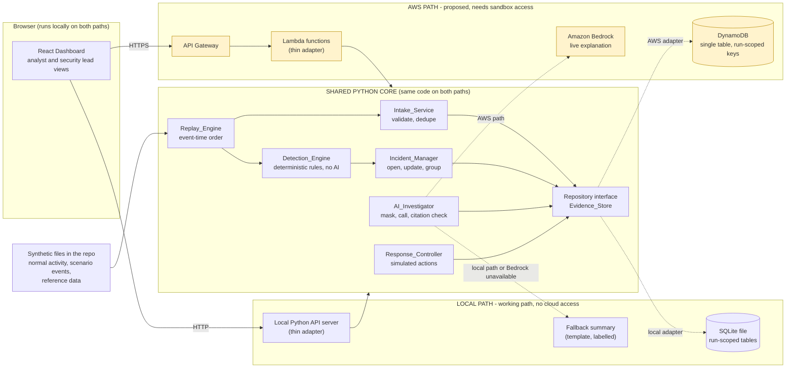
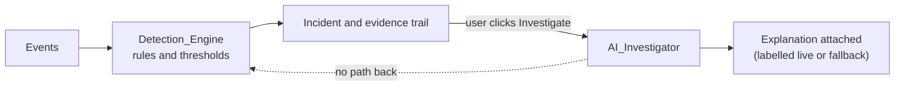
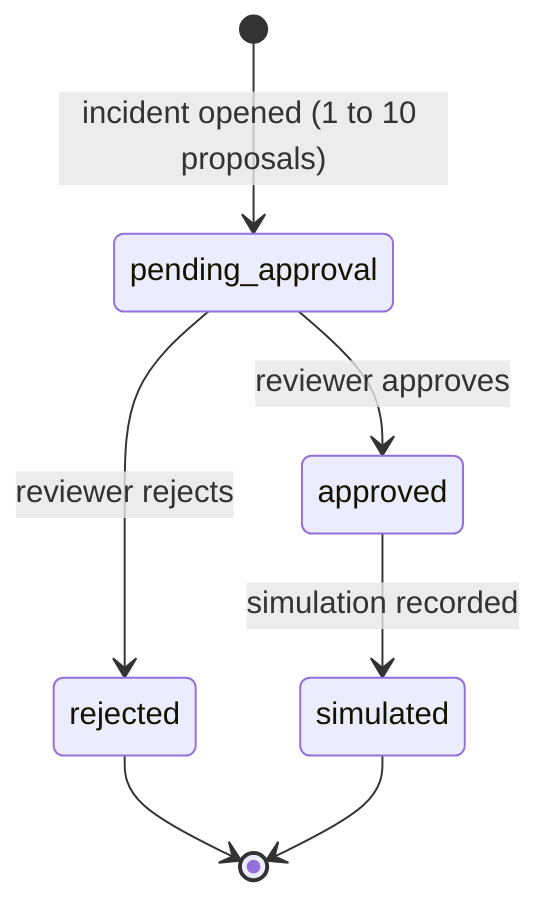

# Design Document

## Overview

FinShield AI helps the security team of a fictional Indian digital lender (an NBFC, a regulated lender that is not a bank) investigate unusual access to customer identity (KYC) documents, loan records, and privileged accounts. This document explains how the system in [requirements.md](requirements.md) will be built. It is planning only. No application code is part of this deliverable.

### Design in one paragraph

Synthetic events enter through one intake step that checks them against one shared event format. A **deterministic** detection engine (plain rules and arithmetic, no AI) applies documented thresholds over event-time windows and opens or updates incidents. Every step writes numbered evidence items to an append-only store. Only after a person asks for it does an **AI investigator** (Amazon Bedrock) explain an incident, using masked facts and evidence IDs. A citation check rejects any answer that cites evidence that does not exist. A reviewer may approve **simulated** response actions. A React dashboard shows it all. The same Python core runs on a laptop (the working path) and on AWS (the proposed path).

### Key design decisions

| # | Decision | Reason |
|---|---|---|
| 1 | Detection results are a pure function of the set of counted events plus the run configuration. | Replays, late events, and duplicates all give the same answer without special cases (R4.4, R5.4, R5.5). |
| 2 | Every stored item lives under a run ID. | Two judges replaying at the same time cannot see or change each other's data (R4.3, R11.8). |
| 3 | A "change one value and replay" action creates a **new run** with a copy of the configuration. | The previous result stays available for the side-by-side view (R4.5, R16.5). |
| 4 | Reference data (approvals, assignments, device history) is read through one lookup type with three outcomes: found, found nothing, unavailable. | "Looked and found nothing" can never be confused with "could not look" (R7.8, R9.11, R9.12, R17). |
| 5 | AI never decides. It only explains, after detection has finished. | R5.1, R13.10. |
| 6 | One shared Python core, thin adapters for local and AWS. | One event format, one set of rules, one set of tests for both paths (R20.5). |
| 7 | Local path needs no cloud access and calls no cloud service. | R20.1. The local AI answer is therefore the labelled fallback summary unless live Bedrock is switched on. |

### How the design supports the three demos

"Three demos" is read here as one demo per priority scenario: **P1** (official demo, shown first, R1.3), **P2**, and **P3**. Each demo also does one change-one-value replay. If the team means something else, tell the design owner and this section changes. Scenario data and numbers live in [scenarios.md](../../../docs/finshield/scenarios.md). The demo script lives in [demo-and-evaluation.md](../../../docs/finshield/demo-and-evaluation.md).

| Demo | What the judge sees | Design parts used |
|---|---|---|
| P1 bulk KYC export | Exports of 80, 90, and 130 documents. No alert at 80. One Critical incident at the second export. The same incident grows to 300 files. Then an approval check, an AI explanation, and a simulated action. | Intake, windows, baseline, approval matching, grouping, AI, response |
| P2 unassigned customer access | A collection partner opens many customers not assigned to them. One High incident whose distinct count grows. | Assignment lookup, distinct counting, grouping |
| P3 possible account takeover | Five failed logins then a login from a new device on one admin account. One High incident and a verification request. | Device history, ordered login sequence, response |

### Source and wording notes

- Planning documents written later: [README.md](../../../docs/finshield/README.md), [scenarios.md](../../../docs/finshield/scenarios.md), [contracts.md](../../../docs/finshield/contracts.md), [demo-and-evaluation.md](../../../docs/finshield/demo-and-evaluation.md), [decisions.md](../../../docs/finshield/decisions.md). These links resolve once the files exist.
- Event and API payload fields are defined only in [contracts.md](../../../docs/finshield/contracts.md). This document names fields in prose and does not copy their definitions.
- Any figure not measured is marked "proposed, not measured" next to the figure (R20.7). All timeouts and sample sizes below are demo settings.
- Compliance wording is "DPDP-aligned readiness and controls". This design makes no legal finding (R18).

### Open decisions

Each unresolved choice is logged in [decisions.md](../../../docs/finshield/decisions.md) with an owner role and a recommended default. The team can build with the default and change it later.

| ID | Open choice | Owner role | Recommended default |
|---|---|---|---|
| [D-01](../../../docs/finshield/decisions.md#d-01) | Local storage: SQLite file or DynamoDB Local (needs Docker) | platform | SQLite file behind the same repository interface |
| [D-02](../../../docs/finshield/decisions.md#d-02) | Baseline method: normal range from the minimum and maximum of normal samples, or a percentile | data/replay | Minimum and maximum of normal samples (matches the 5 to 10 documents example) |
| [D-03](../../../docs/finshield/decisions.md#d-03) | P3 meaning of "after the fifth failure" when more than five failures exist | detection/backend | Count failures since the account's last successful login. Compare the success with the latest failure |
| [D-04](../../../docs/finshield/decisions.md#d-04) | Bedrock model and AWS Region | AI/controls with platform | Choose a model offered in the sandbox Region. Needs official verification of availability |
| [D-05](../../../docs/finshield/decisions.md#d-05) | Show masked placeholders or real synthetic IDs inside AI answers | AI/controls | Keep placeholders in the answer text. Show real IDs only in the incident header |
| [D-06](../../../docs/finshield/decisions.md#d-06) | Where the dashboard is hosted on the AWS path | platform | Run the React app locally against the API Gateway URL. No S3 hosting |
| [D-07](../../../docs/finshield/decisions.md#d-07) | How reviewer identity is chosen in the demo | dashboard | Two fixed demo users (analyst, security lead) chosen from a list. Labelled "demo sign-in, not authentication" |
| [D-08](../../../docs/finshield/decisions.md#d-08) | Upload events and the 15-minute grouping window (R8.1 and R11.1 differ) | detection/backend | R8.1 wins for uploads: attach to the open P1 incident when the upload is later than the earliest export |
| [D-09](../../../docs/finshield/decisions.md#d-09) | Incident event count versus window events (R6.4 and R11.2) | detection/backend | The event that triggers the incident counts as 1. Earlier window events are referenced by the rule result, not counted again |
| [D-10](../../../docs/finshield/decisions.md#d-10) | R17.1 lists four states but a check that finds something has none | dashboard with requirements owner | Add a fifth neutral label "completed, findings shown". The four states stay as written |
| [D-11](../../../docs/finshield/decisions.md#d-11) | Live-event feed (`[DECK]`, R16.8) | dashboard | Not built in the first release |
| [D-12](../../../docs/finshield/decisions.md#d-12) | Closing an incident (R8.7 mentions closed incidents) | detection/backend | No close action in the first release. Tests use a fixture incident marked closed |
| [D-13](../../../docs/finshield/decisions.md#d-13) | Who maintains the legal-finding phrase list used by the citation check | AI/controls | AI/controls role, reviewed with the security lead |

## Architecture

### Architecture diagram

One shared Python core sits behind two thin adapters. Shaded "sandbox" boxes need an AWS sandbox account. Everything else runs on a laptop with no cloud access.



### Local path and AWS path side by side

| Part | Local path (working) | AWS path (proposed) | Needs sandbox access? |
|---|---|---|---|
| Dashboard | React app served by a local dev server | Same React app run locally, calling the API Gateway URL (see D-06) | AWS side only for the API call |
| HTTP entry | Local Python API server | **API Gateway**: public HTTPS entry that forwards each request to a Lambda function | Yes |
| Backend logic | Same Python core inside the local server | **Lambda**: runs the same Python core on demand, one function per API area (intake, replay, incidents, investigate, respond) | Yes |
| Storage | SQLite file (D-01) | **DynamoDB**: key-value database. Run-scoped keys, conditional writes for duplicates | Yes |
| AI explanation | Fallback summary, labelled "fallback" (no outbound cloud request, R20.1). Live Bedrock is optional if credentials exist | **Bedrock**: managed foundation-model service. Called only by the investigator | Yes (live only) |
| Synthetic data | Files in the repository | Same files, read by the replay function at deploy time or uploaded through the API | No |

Each AWS service is the replacement for one local part (R20.2): API Gateway replaces the local server's routes, Lambda replaces the local server's process, DynamoDB replaces the SQLite file, and Bedrock replaces the fallback template as the source of the live explanation.

### Where S3 and EventBridge are used

- **Amazon S3: not used in the first release.** Synthetic event files ship in the repository and are read from disk or bundled with the Lambda package. The dashboard runs locally (D-06). If the team later wants hosted dashboard files or large replay files, S3 gets a named job in a decisions.md entry first (R20.3).
- **Amazon EventBridge: not used in the first release.** Lambda is invoked directly by API Gateway. Nothing in the three demos needs scheduled or fan-out events. The scheduled registry upload (R12.1) is a replayed synthetic event, not a real schedule.

### One shared event format

Both paths accept the same event format, defined once in [contracts.md](../../../docs/finshield/contracts.md) with a MAJOR.MINOR version (R19.1, R20.5). The format is written as a single machine-readable schema file in the repository. The local server, the Lambda functions, the replay files, and the tests all load that one file. Intake returns the same validation result on both paths (R2.5). An event that fails validation is kept unmodified in a "rejected" area for inspection and is never counted (R20.6).

### Deterministic detection, AI explanation only



The investigator reads the finished incident. It has no write access to severity, alert state, or rule results (R13.10). A test compares the incident before and after an explanation.

### Time, duplicates, late events, replays, and grouping

**Event time, not arrival time.** All windows use the event's own timestamp (R5.3). The system clock is used only to stamp when a person acted (approvals, AI requests) and is never an input to a rule.

**Rolling window.** A window of length W ending at time T covers events with time greater than T minus W and up to and including T. For P1 with W of five minutes, an event at 10:00 is inside the window ending at 10:04 and outside the window ending at 10:05.

**Duplicate events.** The key of an event is the pair (run ID, event ID). Intake writes it with "write only if absent". The first copy wins. A second copy returns a "duplicate" result, is not stored again, and is excluded from every count (R2.4, R5.5, R11.7). Because detection is recomputed from the stored set, a duplicate cannot be counted twice.

**Late arrivals.** An event with an event time earlier than events already processed is stored normally. The detection step then re-evaluates that actor and scenario for the run over the full stored set and updates affected incidents within 5 seconds (R5.4, proposed, not measured). Replays never have late events because the Replay_Engine sorts by event time, then by event ID (R4.2). A test shuffles arrival order and expects identical results.

**Repeat replays.** Replaying a run ID that already exists re-feeds the same events. Events are rejected as duplicates. Incident IDs and evidence IDs are derived from content (below), so the same incident is updated in place and the incident count does not change (R4.6).

**Incident grouping.** An incident belongs to one run, one scenario, and one actor. An event joins an open incident of the same run, scenario, and actor when its time is within 15 minutes of the incident's latest event time (R11.1, proposed, not measured). Otherwise a new incident opens. Upload events follow R8.1 instead (D-08).

**Run isolation.** Every key starts with the run ID. Every read and write takes the run ID as a required argument. There is no "all runs" query in the first release. Two judges replaying in parallel get two run IDs and cannot see each other's events, configuration, baselines, reference data, incidents, or counts (R4.3, R11.8). Reference data is copied into each run, so a judge who edits an approval in one run changes nothing elsewhere.

**Content-derived IDs.** The incident ID is `inc-` plus the scenario in lower case plus the ID of the event that triggered the incident, for example `inc-p1-evt-002`. Evidence IDs are built from the type and the source event or incident, for example `rr-evt-002-p1` (rule result) and `al-evt-002` (approval lookup). IDs do not contain the run ID, the actor name, or any customer ID. The same input in two runs therefore yields the same IDs (R15.5), and the IDs are safe to send to Bedrock. Uniqueness is guaranteed inside a run by the storage key (run ID plus ID).

### Normal activity and baseline

1. **Generation.** A seeded generator (Python standard library random, fixed default seed, recorded in the run configuration) writes a *normal activity* file for each account used in P1, P2, and P3. It covers at least 7 consecutive days and at least 30 samples per metric per account (R3.1, proposed, not measured). The P1 admin generates 5 to 10 documents in every five-minute period, inclusive (R3.5). The generator profiles (credit team volume, scheduled registry upload, auditor behaviour) are defined in [scenarios.md](../../../docs/finshield/scenarios.md).
2. **Separate files.** Normal activity and the injected scenario events are separate files. Each event also carries a provenance marker (field name in [contracts.md](../../../docs/finshield/contracts.md)) saying `normal` or `injected`.
3. **Calculation.** The baseline builder reads **only** the normal file and also skips any event whose marker says `injected`, as a second guard (R3.2, R3.3). For P1 the sample is the documents exported by the account in one five-minute period. The normal range is the minimum to the maximum of the samples (D-02). The stored baseline holds account, metric, range, sample size, and the start and end of the period (R3.4).
4. **Too few samples.** With fewer than 30 normal samples, no baseline is stored, an error names the account and metric, and the samples stay (R3.6). Detection then falls back to the role-level baseline (pooled normal samples of comparable privileged accounts, labelled "baseline: role-level"), and then to "baseline missing" (R6.7, R6.8).
5. **Other scenarios.** P2 and P3 use reference data instead of a statistical baseline. The device history used by P3 is built from normal login events only, so the "new device" appears only in injected events.
6. **Run-scoped.** The baseline is computed when a run is created and stored under that run. Changing a threshold cannot alter another run's baseline.

### Research notes that shaped the design

- Bedrock is available through the `bedrock-runtime` endpoint in the Regions where Bedrock is offered, and models differ by Region. The model choice and Region for the sandbox are left open (D-04) because availability must be checked in the actual sandbox. See [Regional availability by models](https://docs.aws.amazon.com/bedrock/latest/userguide/models-region-compatibility.html) and [Bedrock endpoint availability](https://docs.aws.amazon.com/bedrock/latest/userguide/endpoints-region-availability.html).
- The DPDP Rules were reported as notified on 14 November 2025 ([Press Information Bureau document](https://static.pib.gov.in/WriteReadData/specificdocs/documents/2025/nov/doc20251117695301.pdf?v=20260612204505)). Secondary commentary describes breach notice to affected people and the Data Protection Board "without delay", with a more detailed report within 72 hours ([EY summary](https://www.ey.com/en_in/insights/cybersecurity/transforming-data-privacy-digital-personal-data-protection-rules-2025), [Taxmann on Rule 7](https://www.taxmann.com/post/blog/personal-data-breach-intimation-rule-7-dpdp)). These are second-hand. Every mapping and deadline in this design is marked "needs official verification".
- Content was rephrased for compliance with licensing restrictions.

## Components and Interfaces

### Intake_Service (R2, R19.3, R20.6)

Input: one event plus the run ID. Steps, in order, stopping at the first failure:

1. Check the contract version is present and supported. If not, reject and list the supported versions (R19.3).
2. Check the event against the shared schema. Collect all failing field names (up to 50) (R2.3).
3. Check the synthetic marker. A record not marked synthetic is rejected and shown to the user (R1.5).
4. For events carrying document records, require a document ID and customer ID on each record and return the record position and missing field name on failure (R2.6, R2.7). Compare the reported count with the number of listed document IDs. A mismatch is rejected with both numbers (R2.8).
5. Write "only if absent" under (run ID, event ID). Return `accepted` or `duplicate`.

Rejected events store nothing in the run. A copy of the raw rejected input is kept in a separate rejected-input area for inspection (R20.6). Target response time is 500 ms for events up to 1 MB (proposed, not measured).

### Replay_Engine (R4)

- `create_run(event_files, config_overrides)` creates a run ID (`run-` plus 8 random hex characters), copies the default configuration and reference data into the run, applies overrides, builds baselines, and returns within 2 seconds (proposed, not measured).
- `replay(run_id)` loads the stored event file, passes each event through Intake, sorts the accepted events by event time then event ID, and feeds them to Detection one by one.
- A missing, unreadable, or unparseable file stops before the run starts and leaves existing runs unchanged (R4.8). An out-of-range or wrong-type override is rejected, the previous result stays on screen, and the invalid value is named (R4.9).
- **Change one value:** the dashboard sends the changed value. The engine creates a new run from the previous run's input and configuration with that one value changed, replays it, and the dashboard compares the two runs and shows the rule condition behind each difference (R4.5).

### Detection_Engine (R5 to R10, R12)

A set of pure functions. For each rule: inputs are the counted events of one run, the run configuration, and reference lookups. Output is a list of **condition results** and a decision.

**Condition result** has the fields: condition name, value seen, limit, and state. State is one of `pass`, `fail`, or `not_evaluated`. A `not_evaluated` result names the missing source (R5.6, R5.7). `not_evaluated` is never treated as `pass` anywhere.

**Reference lookup result** has three outcomes: `found(records)`, `empty` (the lookup worked and returned nothing), `unavailable(source name)`. In the local path, an "unavailable" outcome is produced by a per-source switch in the run configuration, so the missing-evidence demo repeats exactly.

**Comparison words.** "More than N" means N plus 1 or higher. "At least N" means N or higher (R5.8). With a limit of 100, 100 does not trigger and 101 does. With a multiplier condition of at least five times an upper end of 10, 50 qualifies and 49 does not.

**Configuration.** Every threshold has a demo default and a valid range. A missing, non-numeric, negative, or out-of-range value is rejected. The previous valid value (or the default) stays, and the error names the rule and threshold (R5.9, R10.8, R9.5).

#### P1 rule (R6, R7, R8)

For each export event E by actor A in a run:

| Condition | How it is evaluated | Result if evidence missing |
|---|---|---|
| Volume | Sum of documents exported by A in the window ending at E (default 5 minutes) is **more than** 100 | Not applicable. Volume comes from the events themselves |
| Multiple of normal | The same sum is **at least** 5 times the upper end of A's normal range | `not_evaluated`, names "baseline" (after trying personal, then role-level baseline) |
| Privileged | A is marked privileged in reference data | `not_evaluated`, names "account directory" |
| No covering approval | Approval lookup returned no approval that covers the export | `not_evaluated`, names "approvals source" |

| Volume | Multiple | Privileged | No covering approval | Decision |
|---|---|---|---|---|
| fail | any | any | any | No alert |
| pass | pass | pass | pass | **Critical** incident |
| pass | pass | pass | `not_evaluated` | **High** incident, missing evidence lists "approvals source" (R6.9, R7.9) |
| pass | `not_evaluated` | pass | pass | **High** incident, missing evidence lists "baseline" (R6.8) |
| pass | any | pass | fail (an approval covers it) | No alert. Recorded as **approved activity** (R7.3) |
| pass | fail | any | any | No alert |

When the approvals source later answers `empty`, a re-evaluation raises the same incident to Critical, removes "approvals source" from missing evidence, and records the severity change (R6.10).

**Approval covers an export** only if all five match: actor, operation, record scope, time (export at or after start and before expiry), and destination (R7.1). A partial match produces an uncovered record count (R7.7). On a mismatch the incident shows which of ticket, actor, operation, scope, expiry, or destination differed (R7.4 to R7.6). The Dashboard shows exactly one of "returned a match", "returned no match", or "unavailable" for the lookup, with a 5-second limit (R7.8, proposed, not measured).

**Counts.** Total files is the sum of exported documents. Affected customers is the count of distinct customer IDs across those documents. They are two separate figures (R6.11). Example: 300 files can belong to 180 customers.

**Upload variation (R8).** An upload to an external destination attaches to an existing open P1 incident for the same actor when the incident has at least one export and the upload is later than the earliest export. Each transfer fact carries exactly one label: `observed export`, `attempted upload`, or `confirmed transfer`. "Confirmed transfer" requires an event or receipt saying the destination received the data. Severity stays Critical.

#### P2 rule (R9)

For each record access by a collection agent or loan officer, classify at the access time: `assigned`, `delegated`, `unassigned`, or `unverified`.

| Assignment lookup | Delegation | Class | Counted? |
|---|---|---|---|
| found, covers the customer | n/a | assigned | no |
| found nothing for the customer | none valid at access time | unassigned | yes |
| found nothing | approved and unexpired at access time | delegated | no |
| found nothing | expired before access | unassigned | yes |
| unavailable (error or no answer within 5 seconds, proposed, not measured) | n/a | unverified, "assignment data missing" | no, and the source is listed as missing evidence |

Only **successful** accesses count. The count is the number of distinct customer IDs in the unassigned class for the actor in the rolling window (default 5 customers in 30 minutes, ranges in R9.5). The incident opens as High at the access that reaches the threshold and then updates (R9.4, R9.6).

#### P3 rule (R10)

A successful login S on a privileged account qualifies when all hold:

1. The device is not in that account's device history.
2. The account has at least 5 failed logins counted since its last successful login (per account only, never across accounts, R10.2).
3. S happened 0 to 600 seconds inclusive after the latest of those failures (D-03).

The device history is a lookup. If it is unavailable, no incident opens. The check is recorded `not_evaluated` naming "device history" and the dashboard shows it as a visible non-incident item (R10.6). A success from a known device after 5 or more failures opens nothing (R10.4). The incident shows the chronological login sequence, the full device history, and every event ID used (R10.3).

Boundaries from R10: 4 failures does not trigger. Failures spread over three accounts does not trigger. A new-device success 600 seconds after the last failure triggers. At 601 seconds it does not.

#### Accuracy cases (R12)

Approved activity (registry upload by an approved system account to an approved destination, auditor export under a valid ticket) is recorded as approved activity with zero alerts. An expired or non-covering ticket goes through the standard rules and the dashboard states which check failed (R12.3). The late-night credit-team download of 15 files shows the person's normal volume, the 15 observed, and the rule applied. When evidence is insufficient for Medium, the dashboard shows the real result and a reason of up to 200 characters, never a Medium alert (R12.5). These are accuracy tests, counted apart from the three scenarios (R1.4, R12.6).

### Incident_Manager (R11)

- `apply(decision, run)` finds an open incident by (run, scenario, actor) within the 15-minute gap, or opens a new one with event count 1.
- A new matching event adds 1 to the event count and appends the event to the evidence trail. An event ID already in the trail changes nothing (R11.3, R11.7).
- Severity comes only from the matched rule. A change records old severity, new severity, rule ID, and change time and keeps earlier history (R11.5, R11.6).
- Update time is UTC with millisecond precision, with the IDs of the events that caused the update (R11.4).
- Late-arrival re-evaluation keeps an existing incident's ID when the re-evaluated group overlaps it. A new ID is created only for a group that has no overlap.
- If an upload cannot be attached (for example a closed fixture incident), the evidence is unchanged and the analyst sees an error (R8.7, D-12).

### AI_Investigator (R13, R18.7, R18.8)

Runs only when a person clicks **Investigate** or asks the approvals question.

**Steps**

1. **Build facts.** Take the finished incident. Collect severity, scenario, file count, distinct customer count, each condition result, the approvals lookup state, missing evidence, and the list of evidence IDs with a one-line masked description of each.
2. **Mask.** Replace actor names and every customer identifier with placeholders such as `ACTOR-1` and `CUSTOMER-1`. The mapping stays on the server and is never sent. Incident IDs are replaced with `INCIDENT-1`. Evidence IDs are already free of names.
3. **Masking check.** Scan the final payload for every identifier known to the run and for identifier patterns. If anything is found, do not send. Show "AI request blocked because masking failed" and leave the data unchanged (R18.8).
4. **Call Bedrock** with a 10-second limit (proposed, not measured). Only masked facts and evidence IDs go in. The prompt asks for four labelled parts and tells the model to cite only IDs from the list.
5. **Validate** the answer within 2 seconds (proposed, not measured) with the citation check below.
6. **Record** the result: the explanation text, `source = live` or `fallback`, the incident ID, the request time, and, if rejected, the reason (R13.7).

**Answer format (four labelled parts, R13.2)**

| Part | Content |
|---|---|
| What happened | Plain description of the incident from the facts, with cited evidence IDs |
| Supporting evidence | A list of evidence IDs, each with one sentence of what it shows |
| What remains unknown | Missing evidence and open questions. "None identified" is allowed only when missing evidence is empty |
| One next check | A single action, at most 300 characters (proposed) |

**Citation check (all must pass, otherwise reject)**

| Check | Rejects when | Requirement |
|---|---|---|
| Shape | One of the four parts is missing, or the next check has more than one action or over 300 characters | R13.2 |
| Evidence IDs | Any ID cited in any part is not in the incident's evidence trail. IDs are read from the structured fields and also found by pattern in free text | R13.3, R13.4 |
| Customer counts | Any number stated next to the word "customer" or "customers" differs from the incident's distinct customer count | R13.4 |
| Legal findings | The text contains a phrase from the legal-finding list (for example "breach", "violation", "non-compliant", "illegal", "guilty"), case-insensitive | R13.4, R18.4 |
| Approval status | The approvals state is `empty` and the text does not say no matching approval was found, or the state is `unavailable` and the text says an approval exists or does not exist, or omits that the status is unknown | R13.8, R13.9 |
| Unmasked identifiers | The answer contains any identifier known to the run | R18.7 |

The legal-finding list is a plain phrase list. It can miss a paraphrase, so it is a safety net and not a legal review. This limit is documented and owned by AI/controls (D-13).

If the answer is rejected, it is discarded. The dashboard shows the **fallback summary** labelled as a fallback, and the rejection and reason are recorded (R13.5).

**Fallback summary.** A fixed template filled from the same masked facts. It has the same four parts, cites only IDs from the trail, uses the exact approval wording below, and passes the same checks. It is used when Bedrock gives no response within 10 seconds, returns an error, or the answer is rejected (R13.6). The dashboard says "live model unavailable" in the first two cases (R17.5). The local path uses it by default.

**Live or fallback record.** Every explanation item stores `source` as `live` or `fallback`, linked to the incident and request time (R13.7).

**No state change.** The investigator has no write path to severity or alert state (R13.10).

#### Worked approvals question

Question: "Was this export covered by a valid audit approval?" The answer comes from the approvals lookup state of the incident, not from the model's opinion.

| Lookup outcome | What it means | Required answer |
|---|---|---|
| `found`, an approval covers the export | The system looked and found a covering approval | "A matching approval was found" (this case is `approved activity`, normally no incident) |
| `empty` (**lookup succeeded, no match**) | The approvals source answered and had nothing matching | "No matching approval was found." |
| `unavailable` (**source unavailable**) | The approvals source did not answer | "Approval status is unknown because the approvals source was unavailable." Must not say an approval exists or does not exist |

Example with incident `inc-p1-evt-002`:

- Outcome `empty` (evidence `al-evt-002`, "returned no match"): "No matching approval was found (al-evt-002)." The incident can be Critical.
- Outcome `unavailable` (evidence `al-evt-002`, "unavailable: approvals source"): "Approval status is unknown. The approvals source was unavailable (al-evt-002)." The incident is High and "approvals source" is listed as missing evidence.

An answer such as "No approval exists" under `unavailable` is rejected by the approval-status check even if every evidence ID is real.

### Response_Controller (R14, R10.5)

Only two action types exist: **suspend account** and **request verification**. Both are simulated. Nothing calls any real system (R14.2).



- Each approval or rejection records **who** (reviewer identity), **what** (action type and action ID), **which incident**, and **when** (UTC, second precision) within 2 seconds (R14.3, R14.5, proposed, not measured). The record is an evidence item.
- Simulation happens only after `approved`. The dashboard labels it **simulated** everywhere and never "executed" (R14.6).
- An unauthorised reviewer, or an action that is no longer pending, is refused and the status is unchanged (R14.8). A failed write of the approval keeps the status pending and shows an error (R14.7).
- Request verification (P3) records one request with reviewer identity, the account owner as recipient, and a timestamp (R10.5).
- Reviewer identity in the demo is a chosen demo user (D-07). It is labelled "demo sign-in, not authentication".

### Evidence_Store (R15)

An interface with a small set of operations: `put_if_absent`, `get`, `list_by_run`, `append_evidence`, and `update_incident`. There is no update or delete operation for evidence. A request to change or remove evidence returns an "evidence is immutable" error (R15.6).

- Evidence item types: event, rule result, approval lookup, severity change, AI explanation, response action, approved activity, baseline.
- Each item has an ID, timestamp, and a per-run sequence number. Items are returned ordered by timestamp, then by sequence (R15.1, R15.2).
- The incident record itself is mutable derived state (event count, severity, update time). Every change to it is also written as an immutable evidence item.
- An evidence export lists every item in order with ID, type, timestamp, and source reference. Target is 30 seconds for up to 10,000 items (proposed, not measured). A failure shows an error and changes nothing (R15.7, R15.8).

### Dashboard (R16, R17, R18)

React single-page app with three areas: incident list (up to 100, newest update first, columns per R16.1), incident detail, and a run compare view.

- **Incident detail** shows: each condition with value seen, limit, and result; **files** and **distinct customers** as two labelled numbers; missing evidence or "none missing"; the evidence trail; any AI explanation with a live or fallback label; response actions labelled pending, approved, rejected, or simulated; the run ID (R16.2 to R16.4, R16.7).
- **Compare view** shows the new result beside the previous result and highlights each differing field with the changed rule condition (R16.5).
- Selecting an evidence item loads its source within 2 seconds, or shows "source unavailable" with the item ID while keeping the item (R15.3, R15.4, proposed, not measured).
- A replay that fails or exceeds 60 seconds (proposed, not measured) shows an error and keeps the previous result and the changed input visible (R16.6).
- Compliance text always says "DPDP-aligned readiness and controls", uses "potential" or "may require review", and shows a "Suggest compliance review" action (R18.1, R18.3 to R18.5).

### Screen mock for the P1 incident

This is a text sketch of what the P1 demo shows after the second export. Counts are illustrative.

```text
Run: run-7f3a9c21        Incident: inc-p1-evt-002        Severity: CRITICAL   (rule P1, baseline: personal)
Actor: acct-admin-07 (privileged)       Last updated: 10:02:00 event time   Events attached: 1

Files exported (5-min window): 170       Affected customers: 105   <- two separate figures

Conditions
  Volume in window            seen 170   limit > 100       PASS
  Multiple of normal          seen 170   limit >= 50       PASS   (normal upper end 10, x5)
  Privileged account          seen yes   limit yes         PASS
  No covering approval        seen: returned no match      PASS   (al-evt-002)
Missing evidence: none

Evidence: evt-001, evt-002, rr-evt-002-p1, al-evt-002, bl-001
Explanation: [Fallback summary - live model unavailable]   [Investigate]
Proposed actions (simulated only): Suspend account - pending approval | Request verification - pending approval
```

### Worked example: P1 second export, from intake to screen

Setting: run `run-7f3a9c21`. Account `acct-admin-07` is privileged. Normal range for that account is 5 to 10 documents per five minutes (baseline `bl-001`, from the normal-activity file only). The destination `dest-int-archive` is internal and the device is known. The three events are:

| Event ID | Event time | Documents | Role in the example |
|---|---|---|---|
| `evt-001` | 10:00 | 80 | First export |
| `evt-002` | 10:02 | 90 | Second export (the one traced here) |
| `evt-003` | 10:04 | 130 | Third export |

Trace of `evt-002`:

1. **Intake.** The event reaches the API (local server or API Gateway then Lambda). The contract version is supported, it is marked synthetic, it lists 90 document records each with a document ID and customer ID, and the reported count of 90 equals the 90 listed IDs. The write under (`run-7f3a9c21`, `evt-002`) succeeds. Result: `accepted`. If the same event is sent again, the write is refused and the result is `duplicate`. It is not counted twice.
2. **Ordering.** The Replay_Engine has sorted `evt-001`, `evt-002`, `evt-003` by event time. `evt-001` was already processed. For `evt-001` the window ending at 10:00 holds 80 documents. 80 is not more than 100, so the volume condition fails and no alert opens. The rule result `rr-evt-001-p1` is stored and the dashboard shows "checked, nothing found" for that check.
3. **Window.** For `evt-002` the five-minute window ending at 10:02 covers times after 09:57 up to and including 10:02. That holds `evt-001` (80) and `evt-002` (90). Sum = 170.
4. **Conditions.**
   - Volume: 170 is more than 100. Pass.
   - Multiple of normal: the upper end is 10, so five times is 50. 170 is at least 50. Pass.
   - Privileged: yes. Pass.
   - Approval lookup: the approvals source answered and returned no approval for this actor, operation, scope, time, and destination. Evidence item `al-evt-002` records "returned no match". Condition "no covering approval" passes.
   - All conditions pass, so severity is **Critical**. The detail is stored as `rr-evt-002-p1`.
5. **Counts.** Total files 170. The 170 document records belong to 105 distinct customer IDs (illustrative). Both numbers are stored and shown separately.
6. **Incident.** The Incident_Manager finds no open P1 incident for this run and actor, and opens `inc-p1-evt-002` with event count 1 (D-09). Evidence `evt-001`, `evt-002`, `rr-evt-002-p1`, `al-evt-002`, and `bl-001` are attached. The incident has exactly one Critical severity entry in its history.
7. **Proposed actions.** The Response_Controller proposes two simulated actions, `act-inc-p1-evt-002-1` (suspend account) and `act-inc-p1-evt-002-2` (request verification), both "pending approval".
8. **Screen.** The dashboard shows the mock above. The investigation request is not sent yet.
9. **Investigate (optional).** The analyst clicks Investigate. Masked facts go out: `INCIDENT-1`, severity Critical, 170 files, 105 customers, `ACTOR-1`, the four conditions, "approvals lookup: returned no match", and the evidence IDs listed above. A valid answer cites only those IDs and says 105 customers. An answer citing `evt-009`, saying "about 400 customers", or calling it "a data breach" is rejected and the fallback summary is shown and recorded as `fallback`.
10. **Third export.** `evt-003` (130 documents, 10:04) joins. The window ending at 10:04 covers after 09:59, so it holds 80 + 90 + 130 = 300 files across 180 distinct customers (illustrative). The same incident `inc-p1-evt-002` updates, event count becomes 2, and no second incident opens. Severity stays Critical.
11. **Change one value and replay.** The judge raises the document limit from 100 to 170 for a new run `run-b2c4d8e0`. In that run, at `evt-002` 170 is not more than 170, so the volume condition fails and no incident opens at 10:02. At `evt-003` the sum is 300, so the incident opens there as `inc-p1-evt-003`. The compare view highlights the changed incident, the changed rule condition, and the run IDs. `run-7f3a9c21` is untouched.

### DPDP-aligned readiness and controls

The product supports readiness. It does not certify compliance and does not state that any breach, violation, or non-compliance has happened (R18.4). Wording for any screen or report: "DPDP-aligned readiness and controls", "potential", "may require review".

**Control-to-evidence table**

| Control in FinShield AI | What the system does | Evidence it produces | Requirements | Regulatory mapping |
|---|---|---|---|---|
| Detect unusual access to personal data | Deterministic rules P1, P2, P3 raise incidents | Rule results with value seen, limit, and result | R5, R6, R9, R10 | Reasonable security safeguards: needs official verification |
| Traceable investigation | Append-only evidence trail with IDs and an export file | Ordered evidence export | R15 | Record of incident handling: needs official verification |
| Limit personal data shared with AI | Masking before Bedrock, block on mask failure | Masking-check result, `live` or `fallback` record | R13.1, R18.7, R18.8 | Data minimisation: needs official verification |
| No real personal data in the system | Synthetic-only intake check | Rejected non-synthetic record log | R1.5, R18.6 | Not applicable to a demo. Needs official verification |
| Human review before response | Reviewer approval recorded with who, what, when | Response action evidence items | R14 | Accountability: needs official verification |
| Prompt for compliance review | "Suggest compliance review" action on mapped alerts | Action record on the incident | R18.3 | Breach intimation to the Data Protection Board and affected people, with a 72-hour detailed report reported by secondary sources: needs official verification |
| No overclaiming | Wording rules and legal-finding check | Citation-check rejections | R13.4, R18.1 to R18.5 | Not a legal finding |

### Data access summary

| Data source | Local path | AWS path | Notes |
|---|---|---|---|
| Events, normal activity, reference data | Files in the repo, copied into the run | Same files, loaded by Lambda | Synthetic only |
| Approvals, assignments, device history | Per-run copy, switchable to "unavailable" | Per-run items in DynamoDB | Switch produces the missing-evidence demo |
| Bedrock | Not called by default | Called by AI_Investigator | Needs sandbox access (D-04) |

## Data Models

Field names for events and API payloads are in [contracts.md](../../../docs/finshield/contracts.md). The shapes below are internal storage models and the keys that give run isolation.

### Storage keys (DynamoDB single table, mirrored by SQLite tables)

| Item | Partition key | Sort key | Written how |
|---|---|---|---|
| Run configuration and counters | `RUN#<run_id>` | `CFG` | Created once at run creation |
| Event (accepted) | `RUN#<run_id>` | `EVT#<event_id>` | Conditional write: only if absent |
| Rejected input (raw copy) | `REJ#<run_id>` | `<arrival sequence>` | Plain write, never counted |
| Baseline | `RUN#<run_id>` | `BL#<baseline_id>` | Created at run creation |
| Reference record (approval, assignment, delegation, device history, directory) | `RUN#<run_id>` | `REF#<kind>#<id>` | Copied at run creation |
| Incident | `RUN#<run_id>` | `INC#<incident_id>` | Upsert by deterministic ID |
| Evidence item | `RUN#<run_id>` | `EVD#<evidence_id>` | Conditional write: only if absent. No update or delete code path |
| Response action | `RUN#<run_id>` | `ACT#<action_id>` | Status changes recorded as evidence |

Reading a run's data is one query on the partition key. A run holds a small number of items for the demos (proposed, not measured), so sorting in memory is acceptable. DynamoDB conditional writes are what make "same event twice does not double count" safe when two requests arrive together.

### Core records (conceptual)

```text
Run:        run_id, created_at, config (thresholds, window lengths, seed, source switches),
            contract_version, status
Event:      event_id, run_id, event_time, actor, operation, destination?, device?, outcome?,
            documents[] (document_id, customer_id)?, provenance (normal|injected), synthetic=true
Baseline:   baseline_id, run_id, account (or role), metric, range_low, range_high,
            sample_size, period_start, period_end, scope (personal|role-level)
ConditionResult: name, value_seen, limit, state (pass|fail|not_evaluated), missing_source?
Incident:   incident_id, run_id, scenario, actor, severity, severity_history[],
            event_count, event_ids[], total_files, distinct_customers,
            missing_evidence[], baseline_scope, updated_at, update_event_ids[]
Evidence:   evidence_id, run_id, type, timestamp, sequence, source_ref, payload_ref
Explanation: evidence_id, incident_id, requested_at, source (live|fallback),
            validation (accepted|rejected), rejection_reason?
Action:     action_id, incident_id, type (suspend_account|request_verification),
            status (pending_approval|approved|rejected|simulated),
            reviewer?, decided_at?, recipient? 
```

Rules on the models:

- `distinct_customers` is computed from customer IDs. `total_files` is computed from document IDs. Neither is derived from the other.
- `missing_evidence` is a list of source or field names. The dashboard shows up to 20 and the count of any omitted names (R17.3).
- Baseline `range_low` is less than or equal to `range_high`, and `sample_size` is at least 30 (R3.4).
- An event's `provenance` is read only by baseline building. Detection rules ignore it.

### Result states (R17)

Each check ends in one of four states. A check that finds something shows its findings and the fifth neutral label from D-10.

| State | Meaning | Dashboard text | Example |
|---|---|---|---|
| Successful empty result | The check ran and found nothing | "checked, nothing found", check name, completion time | Assignment feed returned no record for a customer, so the access counts as unassigned. Or the P1 volume check at 80 documents |
| Missing evidence | The check could not run because data was missing | Missing-evidence label plus up to 20 source names | Approvals source timed out |
| Invalid input | The input broke the contract | Error naming each field and rule | Count mismatch of 90 versus 89 |
| Unavailable AI service | Bedrock gave no answer or an error | "Explanation unavailable" plus fallback summary | Bedrock timeout after 10 seconds (proposed, not measured) |

Missing evidence is never shown as "checked, nothing found" and never raises a conclusion about behaviour on its own (R17.6, R17.7).

## Correctness Properties

In this section, a correctness property is a characteristic or behavior that should hold true across all valid executions of a system. It is a formal statement about what the system should do. Properties serve as the bridge between human-readable specifications and machine-verifiable correctness guarantees.

This feature suits property-based testing because detection, windows, grouping, baselines, the citation check, and the response state machine are pure or in-memory logic with large input spaces. It does not apply to the dashboard layout, AWS wiring, or timing targets. Those use the other test types in the Testing Strategy.

**Property reflection.** The prework found overlapping checks that were merged: duplicate handling in intake, detection, and incident grouping became one idempotence property (1). Determinism, repeat replay, and stable IDs became one property (3). The 100 versus 101 and 49 versus 50 boundaries are split into two properties because each has its own limit. Missing-evidence handling for baseline, approvals, assignment, and device history became one property (8). The three AI answer checks (IDs, counts, legal findings) became one citation-check property (20) with the masking check kept separate (22). The verification request (R10.5) is part of the response-action property (24).

### Property 1: Duplicate events never change results

For any sequence of valid events in a run and any way of inserting extra copies of events (same event ID) at any positions, the stored events, rule results, incidents, event counts, file counts, and distinct customer counts are identical to those of the sequence without the extra copies, and each extra copy returns a duplicate result.

**Validates: Requirements 2.4, 5.5, 11.7**

### Property 2: Runs are isolated

For any two runs with any events, configurations, and reference data, and any operation (intake, replay, config change, response action) applied to one run, every read of the other run returns exactly what it returned before the operation. Two events with the same event ID in different runs are both accepted and both counted in their own run only.

**Validates: Requirements 4.3, 11.8**

### Property 3: Replay is deterministic and repeatable

For any event set and configuration, replaying it in two separate runs produces the same incidents, severities, counts, incident IDs, and evidence IDs. Replaying again into an existing run ID leaves the number of incidents per grouped activity at one and the run's incident count unchanged.

**Validates: Requirements 4.4, 4.6, 15.5**

### Property 4: Arrival order does not matter

For any set of events and any arrival order, including late arrivals, the final rule results and incidents are identical to processing the same events sorted by event time then event ID. Ties on event time are broken by ascending event ID.

**Validates: Requirements 4.2, 5.3, 5.4**

### Property 5: Rolling window membership

For any events of one actor, any window length W, and any evaluation time T, the events included in the window ending at T are exactly those with event time greater than T minus W and less than or equal to T. The result does not depend on arrival time or the system clock.

**Validates: Requirements 5.3, 6.1, 9.3**

### Property 6: Volume limit boundary

For any configured document limit L and any window total s, the volume condition passes if and only if s is at least L plus 1. With L equal to 100, 100 does not pass and 101 passes.

**Validates: Requirements 5.8, 6.1**

### Property 7: Multiple-of-normal boundary

For any normal-range upper end u and multiplier m, and any window total s, the multiplier condition passes if and only if s is at least m times u. With u equal to 10 and m equal to 5, 49 does not pass and 50 passes.

**Validates: Requirements 5.8, 6.1**

### Property 8: Missing evidence is never a pass

For any scenario state in which any subset of evidence sources (baseline, approvals source, assignment source, device history) is unavailable, every condition that depends on an unavailable source is recorded as `not_evaluated` naming that source. No incident reaches Critical with a `not_evaluated` condition, the missing sources appear in the incident's missing evidence, and the check is never shown as "checked, nothing found". A P3 check with unavailable device history opens no "possible account takeover" incident. An unavailable assignment lookup is never counted as unassigned. A lookup that succeeded with no record is counted as unassigned.

**Validates: Requirements 5.7, 6.8, 6.9, 7.9, 9.11, 9.12, 10.6, 17.6, 17.7**

### Property 9: P1 severity follows the decision table

For any combination of volume, multiplier, privileged, and approval-coverage condition states, the decision (no alert, High, Critical, or approved activity) matches the P1 decision table, and the same incident is raised from High to Critical, with the severity change recorded, when a missing approvals source later returns no match.

**Validates: Requirements 6.1, 6.7, 6.8, 6.9, 6.10, 7.3**

### Property 10: Files and distinct customers are counted separately

For any set of exported document records, total files equals the number of distinct document records and affected customers equals the number of distinct customer IDs. Total files is greater than or equal to affected customers. A customer with several documents is counted once as a customer and once per document as files.

**Validates: Requirements 6.11, 16.3**

### Property 11: Approval covers an export only when everything matches

For any export and approval, the approval covers the export if and only if actor, operation, record scope, time (at or after start and before expiry), and destination all match. If any one of them is changed, the approval does not cover the export, the incident stays open, and the result names the mismatching item. For a scope that covers only some records, the reported uncovered count equals the number of exported records outside the scope.

**Validates: Requirements 7.1, 7.3, 7.4, 7.5, 7.6, 7.7**

### Property 12: Transfer labels

For any upload event, exactly one label from "observed export", "attempted upload", or "confirmed transfer" is assigned. "Confirmed transfer" appears only when an event or receipt states that the destination received the data. Attaching an upload to a Critical P1 incident leaves its severity Critical.

**Validates: Requirements 8.2, 8.3, 8.4, 8.5, 8.6**

### Property 13: P2 counts distinct unassigned customers only

For any stream of record accesses by an actor with assignments, delegations, and any access outcomes, the counted value in a window equals the number of distinct customer IDs among successful accesses classified unassigned. Failed accesses, assigned accesses, accesses under an unexpired delegation, and unverified accesses add nothing. Repeated access to one customer counts once. A delegation that expired before the access counts as unassigned.

**Validates: Requirements 9.1, 9.2, 9.3, 9.7, 9.8, 9.9, 9.10**

### Property 14: P3 trigger boundaries

For any login sequence, an incident opens if and only if a successful login on a privileged account comes from a device not in the account's history, the account has at least the threshold number of failed logins counted since its last success, and the success occurs 0 to 600 seconds inclusive after the latest failure. Failures on different accounts are never combined. A success from a known device opens nothing. 600 seconds triggers and 601 does not.

**Validates: Requirements 10.1, 10.2, 10.4**

### Property 15: One incident per group, with correct event counts

For any stream of alert-relevant events for one run, scenario, and actor, the number of incidents equals the number of groups separated by gaps larger than the grouping window. Each incident's event count equals the number of distinct events attached to it. Severity history only grows, and each change records old severity, new severity, rule ID, and time. Incidents of different actors, scenarios, or runs are never merged.

**Validates: Requirements 6.4, 6.5, 9.4, 9.6, 11.1, 11.2, 11.3, 11.5, 11.6**

### Property 16: Baseline excludes injected events and is well-formed

For any mix of normal and injected events, the stored sample size equals the number of normal samples only, the range has a lower end less than or equal to its upper end, and changing or removing injected events never changes the baseline. With fewer than 30 normal samples, no baseline is stored and an error names the account and metric. Generated P1 admin samples are within 5 to 10 documents inclusive for every five-minute period.

**Validates: Requirements 3.1, 3.2, 3.3, 3.4, 3.5, 3.6**

### Property 17: Intake rejects invalid input and stores nothing

For any valid event mutated to break the contract (missing field, wrong type, unsupported or missing contract version, a document record missing a document ID or customer ID, a record count that differs from the listed document IDs, or a record not marked synthetic), intake rejects it, the run's stored data is unchanged, and the error names each failing field with its rule. Both adapters return the same validation result for the same input.

**Validates: Requirements 1.5, 2.3, 2.5, 2.6, 2.7, 2.8, 17.4, 19.3, 20.6**

### Property 18: Event serialization round trip

For any valid event, serializing it to the shared format and parsing it back yields an equivalent event, and a valid event that was accepted can be read back from the store unchanged.

**Validates: Requirements 2.2, 20.5**

### Property 19: Configuration validation keeps the last good value

For any rule configuration value that is missing, non-numeric, negative, or outside its allowed range, the change is rejected, the previous valid value (or the default) remains in force, and the error names the rule and the value. Valid values apply to evaluations made after the change.

**Validates: Requirements 4.9, 5.9, 9.5, 10.7, 10.8**

### Property 20: AI citations are a subset of the evidence trail

For any incident and any model answer, the answer is accepted if and only if all of the following hold: it has the four required parts, every evidence ID it cites exists in the incident's evidence trail, every customer count it states equals the incident's distinct customer count, and it contains no legal-finding phrase. A rejected answer is discarded, replaced by a labelled fallback summary, and the rejection reason is recorded. Every recorded explanation states whether it was live or fallback.

**Validates: Requirements 13.2, 13.3, 13.4, 13.5, 13.7**

### Property 21: Approvals answer matches the lookup state

For any incident, the answer to the approvals question says "no matching approval was found" when the lookup succeeded with no match, says approval status is unknown and names the source when the source was unavailable, and never states that an approval exists or does not exist in the unavailable case. The fallback summary follows the same rule.

**Validates: Requirements 7.8, 13.8, 13.9**

### Property 22: Masking blocks identifiers

For any incident facts containing any actor names, customer IDs, and incident IDs, the payload prepared for Bedrock contains none of them and contains only masked facts and evidence IDs. If masking leaves any known identifier in the payload, no request is sent, an error says the request was blocked because masking failed, and the original data is unchanged.

**Validates: Requirements 13.1, 18.7, 18.8**

### Property 23: AI explanation does not change detection state

For any incident and any explanation request, including rejected answers, fallbacks, and Bedrock errors, the incident's severity, alert state, and rule results are identical before and after.

**Validates: Requirements 5.1, 13.10**

### Property 24: Response actions follow the approval state machine

For any sequence of reviewer requests on any set of proposed actions, an action is simulated only after it has been approved. Pending and rejected actions are never simulated. Each approval or rejection records reviewer identity, action, incident, and a timestamp. A request from an unauthorised reviewer or on an action that is not pending is refused with status unchanged. Only the two supported action types exist. A verification request records reviewer, the account owner as recipient, and a timestamp.

**Validates: Requirements 10.5, 14.1, 14.2, 14.3, 14.4, 14.5, 14.8**

### Property 25: Evidence is ordered and immutable

For any set of evidence items recorded in any order, listing returns them in ascending timestamp order, with equal timestamps in recorded order, and an export contains every item with ID, type, timestamp, and source reference. Any attempt to modify or delete an item is rejected with an "evidence is immutable" error and leaves the store unchanged.

**Validates: Requirements 15.1, 15.2, 15.6, 15.7**

### Property 26: Every check has exactly one result state

For any check outcome, the check is assigned exactly one of: successful empty result, missing evidence, invalid input, unavailable AI service, or (D-10) completed with findings. "Checked, nothing found" is shown only for the successful empty result, and missing evidence lists at most 20 names plus a count of omitted names.

**Validates: Requirements 17.1, 17.2, 17.3, 17.5, 17.6, 17.7**

### Property 27: Changing one value shows only caused differences

For any two runs whose configurations differ in exactly one value, the compare result lists only fields that differ between the two results, and attaches the changed rule condition to each differing incident field.

**Validates: Requirements 4.5, 16.5**

## Error Handling

All errors name what failed, never expose stack traces to the dashboard, and leave stored data unchanged unless stated.

| Situation | Behaviour | Result state | Requirements |
|---|---|---|---|
| Event fails contract or has count mismatch | Reject, store nothing in the run, keep a raw copy in the rejected-input area, return failing fields | Invalid input | R2.3, R2.7, R2.8, R19.3, R20.6 |
| Duplicate event ID in a run | Keep first, discard copy, return "duplicate" | Not an error | R2.4 |
| Non-synthetic record | Reject and show the rejection | Invalid input | R1.5 |
| Replay file missing, unreadable, or unparseable | No run starts, existing runs unchanged, file error shown | Invalid input | R4.8 |
| Config value out of range or wrong type | Reject, previous value kept, value named | Invalid input | R4.9, R5.9, R10.8 |
| Fewer than 30 normal samples | No baseline stored, samples kept, role-level baseline tried | Missing evidence | R3.6, R6.7 |
| No baseline of any kind | Multiplier `not_evaluated`, incident opens High | Missing evidence | R6.8 |
| Approvals source unavailable | Condition `not_evaluated`, incident High, missing evidence lists "approvals source" | Missing evidence | R6.9, R7.9 |
| Assignment source unavailable | Access marked "unverified: assignment data missing", not counted | Missing evidence | R9.11 |
| Device history unavailable | No incident, visible non-incident item naming "device history" | Missing evidence | R10.6 |
| Lookup succeeded with nothing | Treated as a real answer (counts as unassigned or "no match") | Successful empty result | R9.12, R13.8 |
| Upload cannot be attached | Evidence unchanged, error shown to analyst | Not applicable | R8.7 |
| Masking fails | No Bedrock call, error "blocked because masking failed" | Not applicable | R18.8 |
| Bedrock timeout (10 s, proposed, not measured) or error | Fallback summary, "live model unavailable" | Unavailable AI service | R13.6, R17.5 |
| Bedrock answer fails citation check | Answer discarded, fallback shown, reason recorded | Not applicable (answer rejected) | R13.5 |
| Approval write fails | Action stays pending, error shown | Not applicable | R14.7 |
| Unauthorised reviewer or action not pending | Refused, status unchanged, reason shown | Not applicable | R14.8 |
| Attempt to modify or delete evidence | Reject with "evidence is immutable" | Not applicable | R15.6 |
| Evidence source cannot be retrieved | Item stays visible, "source unavailable" with item ID | Missing evidence | R15.4 |
| Evidence export fails | Error shown, evidence unchanged | Not applicable | R15.8 |
| Replay fails or exceeds 60 s (proposed, not measured) | Error shown, previous result and changed input stay visible | Not applicable | R16.6 |

**Design rule:** an error in one check does not stop other checks. An unavailable source marks only the conditions that depend on it.

## Testing Strategy

### Approach

Two kinds of tests work together. **Property-based tests** check the universal rules above across many generated inputs. **Example tests** check the exact demo numbers, integration points, and screens. Every test cites at least one requirement ID in its name or tag (R19.5).

### Property-based tests

- **Library:** Hypothesis for Python. Property tests are never hand-rolled.
- **Iterations:** at least 100 per property (Hypothesis `max_examples` of 100 or more).
- **One test per property:** each of Properties 1 to 27 is implemented by exactly one property-based test.
- **Tag format:** each test carries a comment **Feature: finshield-ai, Property {number}: {property_text}**.
- **Generators:** events with random timestamps, actors, document counts and repeated customer IDs; reference data with random matching and non-matching approvals; random source-unavailable switches; random answer text with real and fake evidence IDs, random counts, and legal phrases. Generators produce boundary values on purpose (100 and 101, 49 and 50, 600 and 601 seconds, an event exactly at the window edge).
- **Shared core under test:** tests call the pure core and the repository interface. The same repository contract tests run against the SQLite adapter and a DynamoDB-compatible fake, so both paths keep the same behaviour.

### Example and edge-case tests

| Area | Examples | Requirements |
|---|---|---|
| P1 demo numbers | 80 at 10:00 gives no alert, 90 at 10:02 opens one Critical incident with 170, 130 at 10:04 updates it to 300, 180 distinct customers | R6.3 to R6.5, R6.11 |
| P2 dataset | 120 distinct unassigned records give one High incident with count 120 | R9.13 |
| P3 sequence | Five failures then new-device success, plus the 4-failure, 3-account, and 601-second cases | R10.1 to R10.4 |
| Accuracy cases | Registry upload, auditor ticket valid and expired, 15-file late-night download, Medium not shown on weak evidence | R12.1 to R12.5 |
| AI | Bedrock timeout shows fallback, rejected answer shows fallback, approvals question for `empty` and `unavailable` | R13.5, R13.6, R13.8, R13.9 |
| Response | Approve then simulated label, reject, unauthorised reviewer, failed write | R14 |
| Screens | Incident list, detail with conditions, two figures for files and customers, compare highlight, run ID shown, wording rules | R16, R18 |

### Integration and smoke tests

These do not use property-based testing, because the behaviour does not vary with input or depends on external services.

- **Smoke:** the local path runs the three demos with outbound network blocked and makes zero cloud requests (R20.1). Replay runs with no live connection (R4.7). The release has exactly three scenarios (R1.1). Every task cites a requirement ID (R19.5).
- **Integration (1 to 3 examples each, sandbox account):** API Gateway to Lambda to DynamoDB intake and replay round trip, a live Bedrock call with masked facts, and a conditional-write duplicate test in DynamoDB. These need sandbox access and are run only on the AWS path.
- **Timing targets** (500 ms intake, 2 s run creation, 2 s evidence view, 5 s lookups and incident updates, 10 s AI, 30 s export, 60 s replay) are checked with a few timed example runs and are reported as "proposed, not measured" until a dated measurement with method is recorded (R20.7).

### Scenario acceptance tests

Acceptance test IDs (AT-P1-01 and so on, from the Traceability table in requirements.md) are defined in [demo-and-evaluation.md](../../../docs/finshield/demo-and-evaluation.md). Scenario inputs and expected results are in [scenarios.md](../../../docs/finshield/scenarios.md). Judges run these through the dashboard. The same inputs also run as automated example tests.

### Gaps raised for the requirements owner

Four wording gaps are logged as decisions rather than silently resolved: D-03 (P3 "fifth failure"), D-08 (upload versus grouping window), D-09 (event count at incident creation), and D-10 (a check that finds something has no state among the four). Return to requirements if the owner wants them settled in requirements.md instead.
