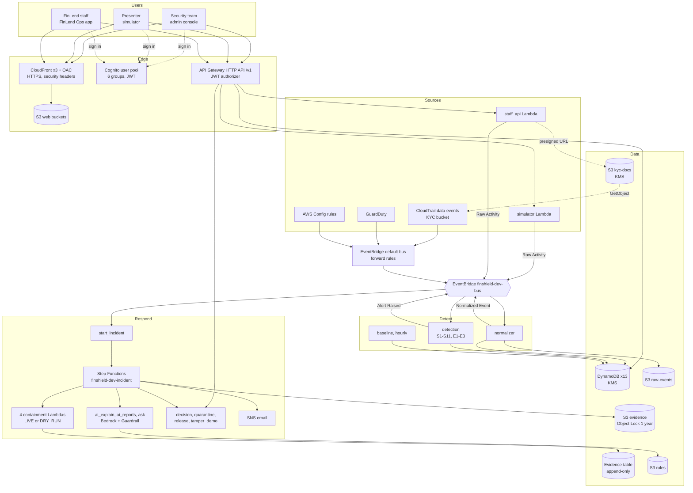

# FinShield AI: high-level design (HLD)

Status: **draft by the integration lead.** The final deploy workflow updates it with the verified URLs and test results.
Marked **(planned)** = being built in the current deploy; everything else is deployed in `finshield-dev`.
All data is synthetic and marked SAMPLE. Region ap-south-1 (Mumbai) only.

## 1. What it is

FinShield watches every access to an Indian digital lender's KYC documents and customer data. It scores each user's
activity against 11 warning signs, raises one alert per user per hour, contains a CRITICAL threat within seconds,
explains it in plain words with Amazon Bedrock, asks the Security Head to approve a lock-down, and seals every step in a
hash chain. It starts the regulator readiness timers: RBI 6 h, CERT-In 6 h, Data Protection Board detailed report 72 h,
from `detected_at`. It provides DPDP-aligned readiness and controls, and SOC 2-aligned and ISO 27001-aligned controls; it
makes no compliance or certification claim.

**Rule that runs through the design:** code computes every number, score and severity. Bedrock only writes words, and
its output is rejected if it contains a number or a regulation clause that code did not supply.

## 2. The three web apps

| App | Folder | Who uses it | What it does | URL |
| --- | --- | --- | --- | --- |
| FinShield admin console | `web/` | Security, compliance, audit (Cognito groups Analyst, SecurityHead, ComplianceHead, Auditor, Admin) | Overview and posture, alerts, alert detail (signals, timeline, AI card, containment, deadlines), approvals, evidence verify and tamper demo, reports, compliance map, accuracy | CloudFront `https://djr2m04eyaclp.cloudfront.net` |
| Simulator | `simulator-web/` | Admin (demo presenter) | Replays SC-01 to SC-10, GuardDuty sample findings, reset | `https://d3ldrhishawn1p.cloudfront.net` |
| FinLend Ops (planned) | `user-web/` | The lender's own staff (Cognito group Staff) | Customer list, customer detail, KYC view/download/upload, read-only consent ledger. Every action becomes an event FinShield monitors; contained users are denied | own CloudFront URL (planned) |

All three are Next.js 14 static exports in private S3 buckets behind CloudFront with Origin Access Control. They call
only the REST API in `contract/openapi.yaml`. Values such as the API URL and Cognito IDs are copied into each build from
the stack outputs (`scripts/write-env.sh`); they are public by design.

## 3. Architecture

`docs/architecture.png` is the slide version of the same picture.

## 4. AWS services and what each does

| Layer | Service | Resources (`finshield-dev-*`) | Job |
| --- | --- | --- | --- |
| Edge | Amazon CloudFront | 1 distribution now, 3 planned; OAC; security-headers policy and index rewrite function (planned) | Serves the three static apps over HTTPS only |
| Edge | Amazon S3 (web) | `web`, plus `simulator-web` and `user-web` (planned) | Private buckets holding the static builds |
| Edge | Amazon Cognito | user pool, web client, groups Admin, Analyst, SecurityHead, ComplianceHead, Auditor, Staff (planned); MFA optional | Sign-in; the ID token carries the groups |
| Edge | API Gateway (HTTP API) | `/v1`, Cognito JWT authorizer, 20 routes + 6 staff routes (planned) | The only door to data; every route checks the group in the handler |
| Ingest | Amazon EventBridge | custom bus `finshield-dev-bus`; 4 forward rules on the default bus | Every hop is an event: Raw Activity, Normalized Event, Alert Raised, Incident Updated |
| Ingest | AWS CloudTrail | trail with S3 data events on the KYC bucket only | Real-mode reads, logins, AssumeRole, StopLogging |
| Ingest | Amazon GuardDuty | detector (only if the account has none) | Threat findings, normalized and shown on the posture view |
| Ingest | AWS Config | recorder (optional), 3 managed rules | Public KYC bucket, CloudTrail on, console MFA; feeds S11 and the Posture table |
| Compute | AWS Lambda | 21 functions (22 with `staff_api`, planned), Python 3.12, arm64, shared layer `finshield` | All logic; see section 5 |
| Compute | AWS Step Functions | Standard state machine `finshield-dev-incident` | Incident workflow: evidence, deadlines, containment in parallel with AI, approval wait, escalation, export |
| Store | Amazon DynamoDB | 13 tables, on-demand, PITR, KMS | Users, Customers, KycFiles, Events, Counters, Baselines, Approvals, Consent (consent ledger), Alerts, Evidence, Reports, Posture, AccuracyRuns |
| Store | Amazon S3 (data) | `kyc-docs` (KMS), `raw-events` (1 year), `rules` (regulation summaries), `evidence` (Object Lock COMPLIANCE, 1 year), `external-sim`, `trail` | Documents, raw archive, prompt context, sealed exports |
| AI | Amazon Bedrock | Converse API, model `mistral.mistral-large-3-675b-instruct` (runs in ap-south-1), temperature 0 | Alert explanation, 4 report drafts, Ask FinShield, KYC image check |
| AI | Bedrock Guardrails | guardrail + version; PII anonymize, Aadhaar and PAN regexes | Filters input and output |
| Respond | AWS IAM | demo role `demo-ops-admin`, demo user `demo-kyc-user`; one role per Lambda | Containment target (inline denies, key deactivation); least privilege |
| Respond | Amazon SNS | topic `alerts` + email subscription | Approval request and escalation email |
| Respond | Route 53 Resolver DNS Firewall | domain list, rule group, VPC association (optional) | Blocks the exfiltration domain; DRY_RUN when off |
| Ops | AWS Systems Manager Parameter Store | `/finshield/dev/` containment_mode, bedrock_model_id, guardrail_id, guardrail_version, kb_id, alert_email | Runtime switches without a deploy |
| Ops | AWS Secrets Manager | demo user access key | Real-mode script only |
| Ops | AWS KMS | data key + alias, rotation on | Encryption at rest for tables and the KYC bucket |
| Ops | Amazon CloudWatch | logs (180-day retention), dashboard, time-to-detect alarm | JSON logs with alert_id and event_id |

## 5. Lambda functions

| Group | Functions | Trigger |
| --- | --- | --- |
| Detect | `normalizer`, `detection`, `baseline` | bus events; hourly schedule |
| Data and demo | `simulator`, `test_runner`, `api` | API routes |
| Staff (planned) | `staff_api` | `/v1/staff/*` |
| Incident | `start_incident`, `set_deadlines`, `evidence` | Alert Raised; Step Functions |
| Containment | `contain_revoke_sessions`, `contain_deactivate_keys`, `contain_bucket_deny`, `contain_dns_block` | Step Functions (CRITICAL) |
| Decision | `decision`, `quarantine`, `release`, `tamper_demo` | Step Functions task token; API routes |
| AI | `ai_explain`, `ai_reports`, `ask`, `kyc_label` | Step Functions; API; S3 Object Created on the KYC bucket |

## 6. Flow A: SC-01, the mandatory demo

1. Admin clicks SC-01 in the simulator. `POST /v1/simulate` replays the scenario's events onto the bus as Raw Activity.
2. `normalizer` turns each into the unified event (`contract/schemas/event.schema.json`), drops duplicates by
   `event_id`, stores it in Events, archives the raw JSON to S3, and emits Normalized Event.
3. `detection` updates the 15-minute and daily counters, compares them with the user's baseline, scores S1-S11 and
   E1-E3 from `contract/config.json`, and upserts the user's one open alert. u-017 reaches 96, CRITICAL:
   S1 40 (212 files, 106x usual), S3 20 (emergency role, no approval), S4 15 (external upload), S5 11 (new device,
   second city), S6 10 (23:40). Each severity step emits Alert Raised.
4. `start_incident` starts Step Functions with the name `<alert_id>-<severity>`, so a duplicate is ignored.
5. The workflow writes evidence, sets the 3 deadlines, then runs two branches in parallel: containment (revoke
   sessions, deactivate keys, bucket deny, DNS block; status CONTAINED) and the AI explanation (8 s budget, template
   fallback). Containment never waits for the AI.
6. It starts the 4 report drafts asynchronously, emails the Security Head, sets AWAITING_APPROVAL and waits 30 minutes
   (then escalates to the Compliance Head and waits again).
7. SecurityHead approves in the console (`POST /decision`); `quarantine` locks the principal; status LOCKED. Reject
   keeps containment and records the reason.
8. The chain is exported to the Object Lock bucket. Verify recomputes the chain; Tamper demo breaks a copy and shows the
   first broken entry. Release undoes every containment step.

## 7. Flow B: a FinLend Ops staff action (planned)

1. Staff `ops.admin@finlend.example` (mapped to u-017) opens a customer and downloads KYC files.
2. `staff_api` checks the Staff group and the mapping, returns a 5-minute presigned S3 URL, and emits a Raw Activity
   event (`source: app`, DOWNLOAD, `data_class: KYC`, the chosen purpose).
3. The same pipeline scores it. Many downloads, or reads without a consented purpose, raise an alert in the console.
4. While u-017 has a CONTAINED, AWAITING_APPROVAL or LOCKED alert, `staff_api` answers 403 ACCESS_CONTAINED and the app
   shows "Access denied: FinShield containment is in place". After Release, access works again.

## 8. Who can do what

| Group | Console | Simulator | FinLend Ops |
| --- | --- | --- | --- |
| Admin | everything, accuracy run, tamper demo | yes | no |
| SecurityHead | read, approve or reject, release, approvals | no | no |
| ComplianceHead | read, approve or reject (escalation) | no | no |
| Analyst | read, Ask FinShield | no | no |
| Auditor | read only | no | no |
| Staff (planned) | no (shown "no console access") | no | own customers and KYC |

Demo logins and the demo password are in `scripts/seed.sh`.

## 9. Security

- Edge: HTTPS only; private buckets reachable only through CloudFront OAC; security headers (planned).
- Identity: Cognito JWT checked by API Gateway on every route; the handler checks the group; console and staff routes
  are separated.
- Least privilege: one IAM role per Lambda; no role has UpdateItem or DeleteItem on the Evidence table; only
  `finshield.evidence.append()` writes it (conditional put on `seq`).
- Evidence: `hash_n = SHA-256(hash_(n-1) + canonical_json(entry_n without hash))` from `GENESIS:<alert_id>`; exports in
  S3 Object Lock COMPLIANCE mode for 1 year.
- Containment: LIVE only when SSM says LIVE, and only ever against `finshield-dev-demo-*` principals; every action is
  reversible by `release`; DRY_RUN records the exact API call instead.
- AI: masked facts only (pseudonymous user, counts, signals, regulation text); no names, Aadhaar or PAN; Guardrail on
  input and output; number and clause checks; template fallback.
- Data: ap-south-1 only, including the Bedrock model; KMS at rest; only Aadhaar last-4 and a fake PAN in tables
  (Aadhaar vault assumption). See `docs/data-handling.md` and `docs/control-mapping.md`.

## 10. Data model

13 DynamoDB tables; shapes in `contract/schemas/` and `docs/integration/backend.md` section 6. Alerts follow
`alert.schema.json`; Evidence follows `evidence_entry.schema.json`; Reports follow `report.schema.json`.

## 11. Operations

- Deploy: `make deploy` (layer + SAM). Web: `make web` (planned: builds the three apps from stack outputs, syncs each to
  its bucket, invalidates its distribution).
- Check: `make test`, `make validate`, `scripts/live_check.py`, `make smoke`, `make accuracy` (11 of 11 scenarios,
  0 false alerts on 7 normal days).
- Logs: `make logs FN=<name>`; CloudWatch dashboard `finshield-dev`.

## 12. Known limits

- The simulator path is the main demo; real mode through CloudTrail adds a few minutes of delivery delay.
- Bedrock latency varies; a slow call falls back to the template text, marked FALLBACK, and the story still holds.
- Deactivate keys is NOT_APPLICABLE for a role principal (SC-01 uses a role); it applies in the real-mode run.
- A later `sam deploy` resets the KYC bucket policy, which removes a bucket-deny containment.
